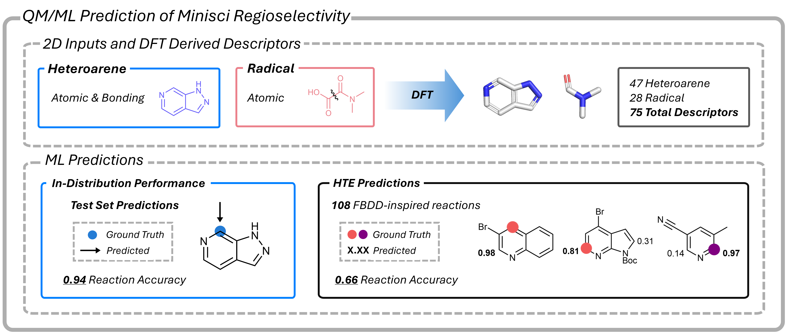

# Predicting Regioselectivity of Minisci Reactions with QM/ML Approaches 



---

### [Hybrid QM/ML approaches for the prediction of regioselectivity in Minisci C-H Functionalisation Reactions](linkhere)

The models presented within this work utilise both the heteroarene and radical structures to make predictions. Each structure is fed into a bespoke toolkit for generation of QM descriptors. 

## Installation and Set-up


### Create Environment
```bash
conda env create -f env.yml --prefix ./venv
```
*or*
```bash
mamba create -f env.yml -p ./venv -y -c conda-forge
```

### Run Example

```bash
python example/run_example.py
```


<!-- ## Examples -->

<!-- ## HTE Set -->

